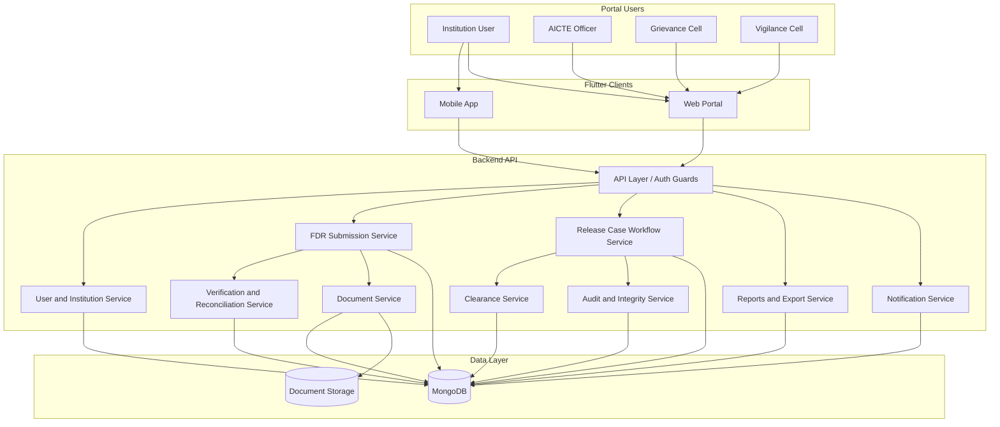

# AICTE FDR Security Deposit and Release Assurance Portal

> A centralized, evidence-driven platform for secure FDR verification, clearance and release management, built with Flutter and a MongoDB-backed API.

**Built for:** Smart India Hackathon (SIH) — AICTE approval workflow automation, compliance monitoring and alert management.

---

## Table of Contents

1. [Overview](#overview)
2. [Problem Statement](#problem-statement)
3. [Solution](#solution)
4. [Key Innovation](#key-innovation)
5. [User Roles](#user-roles)
6. [Workflow](#workflow)
7. [Features](#features)
8. [System Architecture](#system-architecture)
9. [MongoDB Data Model](#mongodb-data-model)
10. [API Endpoints](#api-endpoints)
11. [Tech Stack](#tech-stack)
12. [Getting Started](#getting-started)
13. [Walkthrough Scenario](#walkthrough-scenario)
14. [Roadmap](#roadmap)
15. [Screenshots](#screenshots)
16. [License](#license)

---

## Overview

A role-based portal for managing AICTE Fixed Deposit Receipts (FDRs) / security deposits submitted by institutions. It covers the full lifecycle:

1. Institution submits an FDR
2. Officer reviews the submission
3. Verification against multiple evidence sources
4. Detection and resolution of discrepancies
5. Correction requests
6. Release / refund / closure requests
7. Grievance and vigilance clearance
8. Officer approval and NOC readiness
9. Audit-trail generation
10. Reports and CSV export

**Core principle:**

> Every release decision must be supported by verified evidence, completed clearances and an auditable approval history.

An FDR is never released just because a form was submitted. It must pass several verification and approval gates.

---

## Problem Statement

The manual FDR process suffers from:

- Manual comparison of FDR information
- Delayed verification and inconsistent document checking
- Missing or mismatched bank details
- Difficulty tracking correction history
- Lack of transparency for institutions
- Delayed release/refund processing
- Weak visibility into pending approvals
- Difficulty proving who performed an action
- Risk of releasing an FDR before all clearances are complete
- Fragmented records across documents, officers and departments

These cause administrative delays and increase the risk of financial and compliance errors.

---

## Solution

A central, role-based workflow backed by MongoDB that maintains:

- Institution records and FDR submissions
- Uploaded supporting documents and checksums
- Verification results and discrepancy history
- Release/refund cases and clearance requirements
- Officer decisions
- Notifications and renewal deadlines
- Audit records, reports and exports

---

## Key Innovation

### FDR Evidence Reconciliation and Release Assurance Engine

Most document portals offer form submission, file upload, status tracking and manual approval. This system links **evidence verification directly to release authorization**:

```text
Submission
   ↓
Multi-source evidence comparison
   ↓
Discrepancy detection
   ↓
Correction and reconciliation
   ↓
Document integrity validation
   ↓
Risk and deadline evaluation
   ↓
Grievance / vigilance clearance
   ↓
Controlled release decision
   ↓
Tamper-evident audit record
```

> The system converts FDR processing from a document-submission workflow into an evidence-based release-assurance workflow.

**Guarantees enforced by the workflow:**

- No blind approval
- No release with unresolved blocking issues
- No bypassing the workflow state machine
- Every correction remains traceable
- Every decision has an actor and timestamp
- Document changes can be detected
- Clearance completion is visible

---

## User Roles

| Role | Capabilities |
|---|---|
| **Institution** | Submit FDRs, enter bank/amount/maturity/lien details, attach documents, track status, view verification issues, respond to correction requests, request release/refund/progressive closure/merger handling, receive notifications, track expiries and renewals |
| **AICTE Officer** | Dashboard metrics, review pending submissions, run verification, compare sources, manage discrepancies, request corrections, approve/reject, manage release cases, check clearances, issue NOC-related actions, view reports, export data, verify audit integrity |
| **Grievance Cell** | Review grievance-related cases, add remarks, approve/reject clearance, return cases for more information |
| **Vigilance Cell** | Review flagged/high-risk cases, add observations, approve/reject clearance, escalate suspicious cases, view audit history |

Role permissions are enforced on the server for every API request, not only in the Flutter UI.

---

## Workflow

### 1. Institution submission
The institution enters institution name/ID, FDR number, bank name, deposit amount, issue and maturity dates, tenure, lien information, request type and supporting documents (FDR receipt, request letter, bank confirmation letter, affidavit, clearance documents). The submission is validated before it is accepted and stored in MongoDB.

### 2. Submission status
Submissions start as **Pending Review**. Other statuses: Correction Requested, Verified, Approved, Rejected, Blocked.

### 3. Officer review
The officer dashboard shows pending verification counts, submission lists, institution summaries, action queues, high-priority items, expiry actions and release-case actions.

### 4. Evidence reconciliation
The verification service compares institution name, trust name, FDR number, bank name, amount, issue date, maturity date, tenure and lien information across sources. Results: exact match, partial match, missing data, blocking mismatch, warning mismatch. Each run is stored as a structured verification result.

### 5. Discrepancy management
Each discrepancy records the field, source values, severity, detecting rule, recommended action and full resolution history.
States: **Open → Resolved / Reopened / Waived**.
- A **blocking** discrepancy stops the case until resolved.
- A **warning** can be waived only with a documented officer reason.

### 6. Correction workflow
The officer requests a correction; the institution reviews, updates, re-submits and attaches new documents; the officer re-runs verification. The original submission is never deleted, so the full change history is preserved through versioning.

### 7. Document integrity validation
File extension, MIME type, size limit, SHA-256 checksum, version history and tamper detection. If a file's contents change after upload, the checksum check catches it.

### 8. Release, refund or closure request
Normal release, refund, progressive closure, merger-related release, partial release. Requests include FDR reference, amount, reason, successor institution, merger reference, effective date and supporting documents. Each request becomes a release case.

### 9. Release-case state machine
`Draft → Submitted → Under Review → Verification Pending → Clearance Pending → Ready for NOC → Approved / Rejected → Closed`

Only valid transitions are allowed, and the backend re-checks all conditions on every transition:
- A draft cannot jump directly to approved.
- A case with unresolved blocking discrepancies cannot become NOC-ready.
- A case with incomplete clearances cannot be released.
- A closed case cannot return to an earlier state without an explicit valid transition.

### 10. Grievance and vigilance clearances
Clearance types: grievance, vigilance, financial review, legal review, institutional confirmation. Each tracks type, department, assignee, status, remarks, timestamps, decision and evidence. Final approval is blocked until required clearances are complete.

### 11. Officer approval and NOC readiness
A readiness view shows verification result, blocking/warning discrepancy counts, document integrity, clearance status, case timeline, previous decisions, risk score and recommended action. The officer can approve, reject, request correction, return for clearance, mark ready for NOC, or issue the final NOC where authorized.

### 12. Audit trail
Every important operation creates a hash-chained audit event (event ID, timestamp, actor, role, action, record, payload, previous hash, current hash) stored in MongoDB. Each event depends on the previous event's hash, so tampering is detectable through integrity verification.

### 13. Notifications
New submission, verification completed, correction requested, approved/rejected, clearance pending, FDR expiring soon, FDR matured, release request submitted, NOC issued. Notifications are role-specific, persisted with read/unread state, and linked back to the related record.

### 14. Reports and exports
Submission status, institution-wise, pending verification, discrepancy, release/refund, expiry, clearance-pending, officer action queue, risk summary and audit reports. CSV export protects against formula injection, delimiter problems, quoted values and special characters.

---

## Features

- Role-based institution and officer dashboards
- REST API with MongoDB persistence
- Multi-source FDR evidence reconciliation
- Discrepancy lifecycle (open / resolved / reopened / waived)
- Correction request and re-submission workflow with versioning
- Document checksum and tamper detection
- Release-case state machine with server-side transition validation
- Grievance and vigilance clearance gates
- Notification center
- Renewal and deadline handling
- Hash-chained audit trail with integrity verification
- Reports and safe CSV export
- Responsive layouts for mobile and web

---

## System Architecture



### Component responsibilities

- **Flutter client:** UI only. All authoritative data comes from the API.
- **API layer:** routing, authentication, server-side role checks, request validation, error handling.
- **FDR submission service:** creation, updates, ownership, status, correction versions. Institutions can only access their own submissions.
- **Verification service:** field/source comparison, amount tolerance, date/tenure/bank/lien checks, risk classification.
- **Document service:** upload, type/MIME/size validation, hashing, versioning, access control. File bytes are kept in document storage; metadata and checksums are kept in MongoDB.
- **Release case workflow service:** the state machine, approval/rejection conditions, NOC readiness, progressive closure, merger and refund workflows.
- **Clearance service:** grievance, vigilance, financial and legal clearances with assignment, remarks and escalation.
- **Notification service:** persisted in-app notifications with read/unread state.
- **Audit service:** append-only, hash-chained audit events with server-side timestamps.

Example verification response:

```json
{
  "status": "BLOCKED",
  "totalChecks": 9,
  "blockingIssues": 1,
  "warnings": 2,
  "issues": [
    {
      "ruleId": "deposit-amount",
      "severity": "BLOCKING",
      "field": "depositAmount",
      "message": "Declared amount differs from receipt amount"
    }
  ]
}
```

Example clearance summary:

```json
{
  "required": 3,
  "completed": 2,
  "pending": 1,
  "blocked": false,
  "readyForNoc": false
}
```

---

## MongoDB Data Model

Collections: `users`, `institutions`, `fdrSubmissions`, `documents`, `verificationResults`, `releaseCases`, `clearances`, `discrepancies`, `auditEvents`, `notifications`.

<details>
<summary><b>Sample documents</b></summary>

**`fdrSubmissions`**
```json
{
  "_id": "submission_001",
  "institutionId": "INST-DEMO-0042",
  "fdrNumber": "FDR-EX-884201",
  "bankName": "Example National Bank",
  "declaredAmount": 500000,
  "receiptAmount": 500000,
  "issueDate": "2026-01-01",
  "maturityDate": "2029-01-01",
  "tenureMonths": 36,
  "lienInformation": "No lien",
  "status": "PENDING_REVIEW",
  "currentVersion": 1,
  "createdBy": "user_institution_001",
  "createdAt": "2026-10-26T10:00:00Z",
  "updatedAt": "2026-10-26T10:00:00Z"
}
```

**`documents`**
```json
{
  "_id": "document_001",
  "submissionId": "submission_001",
  "documentType": "FDR_RECEIPT",
  "fileName": "fdr_receipt.pdf",
  "mimeType": "application/pdf",
  "sizeBytes": 183420,
  "objectStorageKey": "fdr/submission_001/document_001.pdf",
  "sha256": "checksum-value",
  "version": 1,
  "status": "VALID",
  "uploadedBy": "user_institution_001",
  "uploadedAt": "2026-10-26T10:00:00Z"
}
```

**`verificationResults`**
```json
{
  "_id": "verification_001",
  "submissionId": "submission_001",
  "status": "BLOCKED",
  "totalChecks": 9,
  "blockingIssues": 1,
  "warnings": 1,
  "sourceValues": {
    "institution": {},
    "fdrReceipt": {},
    "bankConfirmation": {},
    "affidavit": {}
  },
  "issues": [
    {
      "ruleId": "deposit-amount",
      "field": "depositAmount",
      "severity": "BLOCKING",
      "message": "Amount mismatch",
      "status": "OPEN"
    }
  ],
  "verifiedBy": "user_officer_001",
  "verifiedAt": "2026-10-26T10:15:00Z"
}
```

**`releaseCases`**
```json
{
  "_id": "case_001",
  "submissionId": "submission_001",
  "institutionId": "INST-DEMO-0042",
  "caseType": "NORMAL_RELEASE",
  "requestedAmount": 500000,
  "status": "CLEARANCE_PENDING",
  "requiredClearances": ["GRIEVANCE", "VIGILANCE"],
  "createdAt": "2026-10-26T11:00:00Z",
  "updatedAt": "2026-10-26T11:30:00Z"
}
```

**`clearances`**
```json
{
  "_id": "clearance_001",
  "caseId": "case_001",
  "type": "VIGILANCE",
  "status": "PENDING",
  "assignedTo": "user_vigilance_001",
  "remarks": null,
  "createdAt": "2026-10-26T11:00:00Z",
  "completedAt": null
}
```

**`discrepancies`**
```json
{
  "_id": "discrepancy_001",
  "submissionId": "submission_001",
  "ruleId": "deposit-amount",
  "field": "depositAmount",
  "severity": "BLOCKING",
  "status": "OPEN",
  "history": [
    {
      "action": "DETECTED",
      "actor": "verification-service",
      "timestamp": "2026-10-26T10:15:00Z"
    }
  ]
}
```

**`auditEvents`**
```json
{
  "_id": "event_001",
  "entityType": "RELEASE_CASE",
  "entityId": "case_001",
  "actorId": "user_officer_001",
  "actorRole": "OFFICER",
  "action": "CASE_TRANSITION",
  "payload": { "from": "UNDER_REVIEW", "to": "CLEARANCE_PENDING" },
  "previousHash": "previous-hash",
  "eventHash": "current-hash",
  "createdAt": "2026-10-26T11:30:00Z"
}
```

</details>

### Indexes

```text
fdrSubmissions:
  { institutionId: 1, createdAt: -1 }
  { fdrNumber: 1, bankName: 1 }
  { status: 1, updatedAt: -1 }

releaseCases:
  { institutionId: 1, createdAt: -1 }
  { status: 1, updatedAt: -1 }
  { submissionId: 1 }

discrepancies:
  { submissionId: 1, status: 1 }
  { severity: 1, status: 1 }

auditEvents:
  { entityType: 1, entityId: 1, createdAt: 1 }
  { actorId: 1, createdAt: -1 }

notifications:
  { recipientId: 1, read: 1, createdAt: -1 }
```

---

## API Endpoints

```text
POST   /api/auth/login
POST   /api/auth/refresh
GET    /api/institutions/me
POST   /api/fdr-submissions
GET    /api/fdr-submissions
GET    /api/fdr-submissions/:id
POST   /api/fdr-submissions/:id/verify
POST   /api/fdr-submissions/:id/corrections
POST   /api/release-cases
GET    /api/release-cases/:id
POST   /api/release-cases/:id/transition
POST   /api/release-cases/:id/clearances
GET    /api/release-cases/:id/audit
GET    /api/reports
GET    /api/reports/export
```

---

## Tech Stack

| Layer | Technology |
|---|---|
| Frontend | Flutter, Dart, Material 3 (Android, iOS, Web) |
| Backend | Node.js with NestJS / TypeScript |
| Database | MongoDB (indexed collections, transactions for workflow transitions) |
| Document storage | File/object storage with metadata and checksums in MongoDB |
| Auth | Token-based authentication with server-side role-based access control |
| Testing | Flutter widget and unit tests |

---

## Getting Started

### Prerequisites
- [Flutter SDK](https://docs.flutter.dev/get-started/install) (stable)
- Node.js 18+ and npm
- MongoDB (local instance or MongoDB Atlas)

### 1. Clone

```bash
git clone <your-repo-url>
cd <your-repo-folder>
```

### 2. Start the backend

```bash
cd backend
npm install
cp .env.example .env
```

Edit `.env`:

```env
PORT=3000
MONGODB_URI=mongodb://localhost:27017/aicte_fdr
JWT_SECRET=change-me
```

```bash
npm run start:dev
```

### 3. Start the Flutter app

```bash
cd ../app
flutter pub get
flutter run              # mobile / desktop
flutter run -d chrome    # web
```

Point the app at your API base URL in its configuration file.

### 4. Run tests

```bash
flutter test
cd ../backend && npm test
```

---

## Walkthrough Scenario

Use one deliberately mismatched FDR:

```text
Declared amount:     ₹5,00,000
Bank receipt amount: ₹4,50,000
```

1. Institution submits the FDR.
2. Officer opens the pending record.
3. Verification detects the mismatch.
4. The case becomes **Blocked**.
5. Officer requests a correction.
6. Institution receives a notification.
7. Institution updates the amount.
8. Officer re-runs verification.
9. The discrepancy is resolved.
10. Officer starts the release workflow.
11. Clearance status is displayed.
12. The audit trail shows every action.
13. A report is exported.

---

## Roadmap

- [ ] Government SSO and MFA / OTP
- [ ] Bank / FDR verification API integration
- [ ] OCR and document extraction
- [ ] Virus scanning for uploaded documents
- [ ] Email, SMS and push notification delivery
- [ ] Independent append-only audit store with external anchoring
- [ ] Dedicated grievance-cell and vigilance-cell dashboards
- [ ] Scheduled reports and impact metrics

---

## Screenshots

<!-- Add screenshots here -->

| Institution dashboard | Officer dashboard | Discrepancy review |
|---|---|---|
| _coming soon_ | _coming soon_ | _coming soon_ |

---

## License

Add your license here (e.g. MIT).
